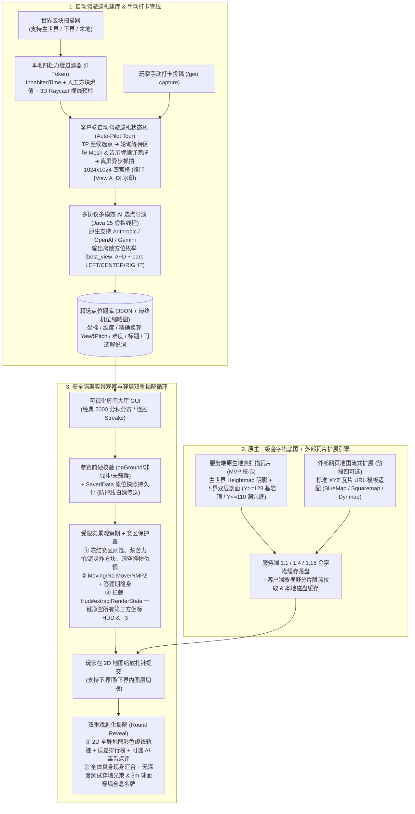

# Minecraft 26.3 (Fabric) GeoGuessr Mod (CraftGuessr) 终极架构设计与实现计划 (v2.0 防踩坑修订版)

> [!IMPORTANT]
> **核心定位**：专为**熟人服、建筑服、RPG 大地图与周目纪念活动**打造的多人/单人实景地理猜谜 Mod。
> 本 v2.0 计划已深度融合 Minecraft 底层引擎约束与 `26.3`（无混淆 + Renderpearl + SDL3 + Java 25）最新特性，彻底解决了**远端区块异步网格编译抓拍、AI 连续角度幻觉、下界基岩层遮挡、瓦片网络包限流、生存服真身传送刷怪炸家、以及室内 3D 射线穿墙渲染**六大工程深水区问题。

---

## 1. 整体系统架构 (v2.0)



---

## 2. 核心模块详细设计（含六大底层深坑工程方案）

### 模块一：原生三级金字塔底图引擎与下界双层剖面（破除黑雾 & 防炸服）

1. **服务端原生三级金字塔瓦片（Mipmap Pyramid）与网络分片限流**
   - **为什么不用单层大图直发**：Fabric `CustomPacketPayload` 单包大小受限，高频全图下发会直接塞爆玩家 Netty 通道导致 `Disconnect: Timeout / Packet too large`。
   - **金字塔落盘与增量同步**：服务端按区块（`16x16`）扫描色彩与高度阴影，在服务端后台（利用 Java 25 虚拟线程）预聚合出 **`1:1`（高精度街景级）、`1:4`（中观城镇级）、`1:16`（全服宏观级）** 三级缩放瓦片块并持久化保存在世界目录 `data/craftguessr/tiles/` 下。
   - **客户端本地磁盘缓存**：客户端根据当前地图 UI 的缩放层级与视口坐标按需请求瓦片（带 Token Bucket 速率限制，每秒最多下发 N 个分片），并在客户端本地按 `ServerID_Dimension_Zoom_TileXZ.png` 缓存，二次打开零网络开销。
2. **下界双层剖面扫描（解决下界 `Y=127` 基岩死局）**
   - 主世界与末地直接使用 `Heightmap.Types.WORLD_SURFACE` + 水深/坡度明暗着色（Hillshading）。
   - **下界专属双层扫描**：下界不能用 `Heightmap`（否则全图只是 `Y=127` 的纯灰基岩板），扫描器对下界区块生成两套图层：
     - **图层 A「基岩顶交通层（Nether Roof，`Y >= 128`）」**：专供建造了下界顶冰道/交通枢纽的服务器，扫描基岩层之上的建筑与冰道。
     - **图层 B「下界内剖面层（Nether Interior，`Y <= 110`）」**：从 `Y=110` 向下搜索首个非空气且下方有支撑的固体方块表面，清晰还原下界要塞、猪灵堡垒与下界大厅道路。
   - **UI 图层切换**：当题目位于下界时，2D 扎针地图右上角自动显示**「切换：基岩顶 / 下界内」**按钮。
3. **外部网页地图 XYZ 瓦片模板扩展（阶段四锦上添花）**
   - 彻底放弃闭源且跨版本极易破碎的 Xaero 本地私有缓存格式解析。
   - 在阶段四提供通用的 HTTP 瓦片流式替换层：服主只需在配置中填入标准瓦片 URL 模板（如 `http://map.example.com/tiles/{world}/{z}/{x}_{y}.png`），客户端即可用网页地图瓦片无缝替换原生底图。

---

### 模块二：可调初筛 + 自动驾驶巡礼相机 + 离散方位 AI 选点导演

1. **多档位本地初筛（0 Token 过滤 90% 废点）**
   - **四档筛选力度可选**（GUI 滑块切换）：
     - **严格建筑区档（Strict）**：高 `InhabitedTime` + 高人工建筑方块占比与种类熵值（剔除纯火把矿道、平整农田、单调刷石机）。
     - **均衡聚落档（Balanced - 默认）**：兼顾中型据点、村庄改造、交通枢纽、特色地形建筑。
     - **宽松寻踪档（Relaxed）**：连野外小路标、小凉亭、矿洞入口、微改造营地也纳入候选。
     - **荒野随机档（Wild）**：仅做地表安全落脚与防卡墙检测，允许自然奇观入选。
   - **本地 3D Raycast 视线预检**：在候选落脚点向四周发射射线，直接用代码剔除贴脸卡墙、钻在树叶堆里、掉进狭窄深坑或视野 80% 以上全是泥土/石头的废机位；同时收集周围 32 格内的**非自然方块统计摘要**与**告示牌（`SignBlockEntity`）文本**。
2. **客户端「自动驾驶巡礼状态机（Auto-Pilot Tour）」抓拍（解决远端区块未加载黑屏悖论）**
   - **摒弃隔空瞬拍与服务端等轴测兜底**：客户端 `ClientLevel` 无法隔空渲染未接收、未完成网格编译的远端区块；服务端等轴测色块图也无法供 AI 判断第一人称遮挡。因此题库生成统一采用**「管理员客户端自动驾驶巡礼」**或**「玩家平时手动打卡投稿（`/geo capture`）」**。
   - **自动巡礼状态机流程**：
     1. `TELEPORTING`：将管理员切为观察巡礼状态，传送至候选点 `(X, Y, Z)`。
     2. `WAITING_MESH`：每帧轮询 `LevelRenderer#isSectionCompiledAndVisible`（26.3 API），确保周围半径 4 区块内的所有非空 Section 已完成客户端 VBO/Mesh 编译，且周围 `SignBlockEntity` 数据已同步完毕（设超时保护如 5 秒）。
     3. `CAPTURING_QUAD`：锁定视角在正北（`Yaw = -180°`）、正东（`Yaw = -90°`）、正南（`Yaw = 0°`）、正西（`Yaw = 90°`）四个方向（90° FOV），通过离屏 `RenderTarget` 与 **26.3 异步截图接口 `Screenshot.takeScreenshot(renderTarget, consumer)`** 依次抓拍 4 张 `512x512` 画面。
     4. `STITCHING_WATERMARK`：合成一张 **`1024x1024`（JPEG 85% 质量）的四宫格拼图**，并用代码直接在四个象限左上角烙印清晰白字黑边水印：
        - 左上：`[View A: NORTH (Yaw 180)]`
        - 右上：`[View B: EAST (Yaw -90)]`
        - 左下：`[View C: SOUTH (Yaw 0)]`
        - 右下：`[View D: WEST (Yaw 90)]`
3. **多协议 AI 选点导演（离散方位 Schema + Java 25 虚拟线程）**
   - **原生三大协议支持**：使用 Java 25 `HttpClient` + `Executors.newVirtualThreadPerTaskExecutor()` 异步请求，原生支持 **Anthropic Messages API (`/v1/messages`)**、**OpenAI Chat Completions (`/v1/chat/completions`)** 与 **Google Gemini (`generateContent`)**，支持自定义 Base URL 与模型名。
   - **严禁 AI 捏造连续角度，改用离散分类 Schema**：
     要求 AI 返回如下极简 JSON（避免掉进两图拼接缝或算错 MC 坐标系）：
     ```json
     {
       "keep": true,
       "best_view": "B",
       "pan": "LEFT_30",
       "pitch": "UP_15",
       "difficulty": "MEDIUM",
       "title": "云杉钟楼侧巷",
       "commentary": "可选：揭晓时的幽默点评（仅在配置开启时生成以省 Token）"
     }
     ```
   - **Java 侧精确角度换算与封面补拍**：
     - Java 代码根据 `best_view`（`A=-180°, B=-90°, C=0°, D=90°`）叠加 `pan`（`LEFT_30 = -30°, CENTER = 0°, RIGHT_30 = +30°`）与 `pitch`（`UP_15 = -15°, LEVEL = 0°, DOWN_15 = +15°`）算出最终精确的 `(Yaw, Pitch)`。
     - 将该点位与当时对应的 `512x512` 视图（或按最终微调角度补拍的一张缩略图）存入题库，供管理员在「题库相册 GUI」中预览或微调。

---

### 模块三：安全隔离实景观察、赛区防爆保护与一键防作弊净空

1. **参赛前状态硬校验与 `SavedData` 原位快照回溯（防白嫖传送 & 防摔死丢坐骑）**
   - **参赛硬校验**：玩家点击“准备/开始”时，服务端强制检查 `player.onGround() && !player.isPassenger() && !player.isFallFlying() && !player.isInLava()` 且近期未受伤害，否则提示“请先在安全地面下马/落地后再加入比赛”。
   - **持久化原位快照**：开赛瞬间将玩家原始坐标、维度、朝向、原游戏模式写入基于 `26.3 SavedDataType + Codec` 的 `PlayerSnapshotSavedData` 并立即 `setDirty()`。无论比赛正常结束、中途退赛还是**掉线重连**，必定在登录/退赛钩子中将玩家精准还原回参赛前位置。
2. **赛区实体冻结与防爆保护罩（消除生存服“蝴蝶效应”）**
   - 当参赛玩家真身传送至目标建筑点观察时，目标点周围区块会被加载。为防止夜晚刷出苦力怕炸毁老玩家基地或咬死村民：
   - 在当前激活题目坐标半径 $R+64$ 格的赛区保护罩内，服务端自动开启临时保护：
     - **禁止自然刷怪**：拦截该区域内的怪物自然生成；
     - **防爆与防破坏**：拦截区域内一切苦力怕爆炸、恶魂火球、凋灵或末影人搬运方块行为；
     - **零仇恨与无敌隔离**：参赛玩家处于无敌、禁交互、饱食度锁定状态，且周围敌对生物无法将参赛玩家设为攻击目标；答题观察期间参赛玩家默认彼此隐身（可在房间设置切换为可见）。
3. **观察限制档位（Moving / No Move / NMPZ）**
   - **Moving（限半径走动）**：允许在起点半径 $R$ 格内走动，提供“返回起点旗帜”快捷键。
   - **No Move（禁止移动）**：服务端与客户端同步锁定双脚 `(X, Y, Z)`，仅允许 360° 转头与 FOV 缩放。
   - **NMPZ（禁止移动、转头、缩放）**：完全锁定在 AI 钦定的 `(Yaw, Pitch)` 与标准 FOV。
4. **26.3 原生级防作弊：一键净空第三方 HUD + 君子协定**
   - 隐藏原版 `DebugScreenOverlay`（F3）以及原版指南针、时钟、地图物品的朝向渲染；
   - **终极低成本屏蔽第三方坐标 Mod**：在 `26.3` 中，所有第三方 HUD Mod 均通过 `HudElementRegistry` 注册并在 `Hud#extractRenderState(GuiGraphicsExtractor, DeltaTracker)` 中提取渲染状态。在开启“严格防作弊”的房间里，答题观察期直接通过 Mixin 接管 `Hud#extractRenderState`，**仅提取本 Mod 自身的猜谜 HUD（倒计时、指南针/小地图扎针窗），直接跳过所有其他第三方 Mod 的 HUD 元素提取**！无需挨个适配 MiniHUD、Sodium Extra 或 Xaero，一招屏蔽所有左上角坐标显示！

---

### 模块四：双重戏剧化揭晓（2D 地图轨迹 + 3D 穿墙全息罗盘光束）

每回合全员提交或倒计时归零后，进入 **6~8 秒的揭晓阶段（Round Reveal）**：
1. **2D 全屏/半透明地图轨迹结算面板**
   - 自动展开大地图，动态绘制每位玩家的扎针点到正确答案的**彩色虚线动画**，侧边栏列出全员误差米数、本题得分（5000 分自适应指数衰减）、总分排名变动或连胜（Streaks）计数，并展示本题标题与（可选的）**AI 趣味揭晓点评**。
2. **全员真身汇合 + 3D 穿墙光束与 3 米球面穿墙全息名牌（解决室内面壁遮挡）**
   - 揭晓瞬间，所有参赛玩家在正确答案位置**解除隐身现身汇合**（可按 `Tab` 或点击最小化地图面板观看 3D 实景互动）。
   - **穿墙半透明光束与脚底罗盘环**：针对室内、窄巷或密林容易被墙壁挡住视线的问题，在 `LevelRenderEvents.AFTER_TRANSLUCENT_TERRAIN` 阶段，使用**无深度测试的自定义渲染管线（`RenderPipeline.builder(...).withDepthStencilState(Optional.empty())`）**从靶心向每位玩家猜测的方向绘制穿墙彩色光束与地面方位罗盘环。
   - **3 米球面穿墙浮空名牌（See-Through Billboard）**：在距离靶心半径 **3 米** 的视线球面交点上，渲染开启了 `seeThrough`（穿墙可见）的浮空全息名牌：`[玩家名] ➔ 东北偏北 428m (+3,120分)`。哪怕全员站在狭小的地下室里，也能穿透墙壁清晰看到每位队友到底猜偏到了哪个方向！

---

## 3. 防烂尾四阶段实施路线（Agile Roadmap）

> [!TIP]
> 采用**「先跑通核心可玩闭环（MVP），再叠视觉特效与 AI 自动化」**的推进顺序，确保第一阶段写完就能进服开黑测试。

### 阶段一：最小可玩闭环（MVP）—— 手动打卡 + 原生金字塔底图 + 单局猜谜
- *目标：不依赖外部 AI 与外部网页地图，先让整个猜谜游戏在 26.3 服务器里完整跑通！*
1. 初始化 Minecraft `26.3` 无混淆 Fabric 工程（Java 25 + `net.fabricmc.fabric-loom`），跑通 `CustomPacketPayload` 网络协议。
2. 实现**服务端原生三级金字塔瓦片生成器**（含主世界 Heightmap 阴影与**下界双层剖面**）+ 客户端本地磁盘缓存与丝滑缩放扎针地图 UI。
3. 实现 `/geo capture [标题] [难度]` 手动打卡建题入库。
4. 实现单局核心循环：参赛硬校验 + `SavedData` 原位快照保护 ➔ 传送观察（含赛区防刷怪/防爆保护罩、Moving/No Move/NMPZ 限制、`Hud#extractRenderState` 屏蔽 F3 与第三方 HUD）➔ 2D 地图扎针提交与 5000 分计分结算。

### 阶段二：双重戏剧化揭晓与完整大厅 GUI
- *目标：拉满多人聚会节目效果与完整赛制体验。*
1. 实现揭晓阶段的 **2D 地图动态虚线轨迹排行榜面板**。
2. 实现揭晓阶段的 **3D 穿墙彩色光束（无深度测试管线）+ 3 米球面穿墙全息浮空名牌** 与全员现身互动。
3. 实现可视化**房间大厅 GUI**（支持切换「经典 5000 分积分赛」与「连胜刷题 Streaks 模式」、设置回合数/限时/移动限制/隐身开关）。

### 阶段三：自动驾驶巡礼相机 + 多协议 AI 选点导演 + 题库相册 GUI
- *目标：接入你的 API Key，实现全自动高质量题库生成与可视化管理。*
1. 实现本地四档力度区块初筛器（Strict / Balanced / Relaxed / Wild）+ 本地 3D Raycast 视线遮挡预检 + `SignBlockEntity`（26.3 `SignTextSlot`）文本提取。
2. 实现客户端**「自动驾驶巡礼状态机（Auto-Pilot Tour）」**：TP 候选点 ➔ 等待 `LevelRenderer#isSectionCompiledAndVisible` 区块网格编译完成 ➔ 异步 `Screenshot.takeScreenshot` 抓拍并合成带 `[View A~D]` 水印的 `1024x1024` 四宫格拼图。
3. 基于 Java 25 虚拟线程接入 **Anthropic / OpenAI / Gemini** 原生多模态接口（采用离散方位枚举 JSON Schema 换算精确 Yaw/Pitch，支持可选开关解说词以省 Token）。
4. 完成可视化**题库相册管理 GUI**（预览缩略图、修改难度标题、一键删题、触发巡礼扫描进度条）。

### 阶段四：外部网页地图扩展与压测打磨（锦上添花）
1. 实现标准 XYZ 瓦片 URL 模板适配器（支持接入服务器已有的 BlueMap / Squaremap / Dynmap 2D 瓦片流）。
2. 进行多人同房间瓦片分片限流压测、掉线重连快照恢复测试与边缘情况打磨。
