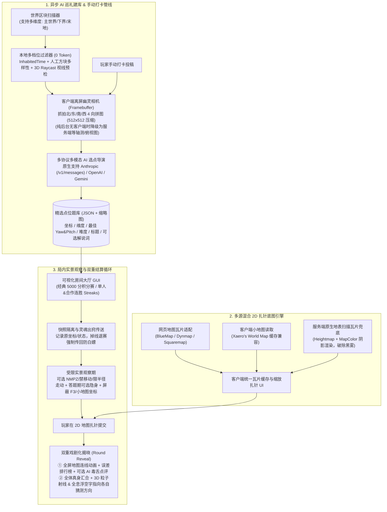

# Minecraft 26.3 (Fabric) GeoGuessr Mod 设计与实现计划

> [!IMPORTANT]
> **核心定位**：专为**熟人服、建筑服、RPG 大地图与周目纪念活动**打造的多人/单人实景地理猜谜 Mod。通过**「可调力度区块初筛 + 客户端离屏幽灵相机 3D 抓拍 + 多模态 AI 选点导演」**自动从存档中挖掘有梗、有建筑、有刁钻视野的精彩机位，结合**沉浸式灵魂出窍实景观察**与**全屏地图连线 + 3D 全息射线双重揭晓**，拉满服务器聚会节目效果。

---

## 1. 整体系统架构

---

## 2. 核心模块详细设计

### 模块一：可调力度的本地初筛 + AI 视觉选点导演（省 Token 管线）

1. **多档位筛选力度（Filter Strength，支持 GUI 滑块与预设档位切换）**
   - **严格建筑区档（Strict）**：高 `InhabitedTime`、高人工建筑方块占比与种类丰富度（剔除纯火把矿道、平整农田、单调刷石机），适合大型建筑服或老生存服主城区。
   - **均衡聚落档（Balanced - 默认）**：兼顾中型据点、村庄改造、交通枢纽、特色地形建筑。
   - **宽松寻踪档（Relaxed）**：连野外小路标、小型亭子、矿洞入口、微改造营地也纳入候选，适合刚开服不久或地广人稀的存档。
   - **荒野随机档（Wild）**：仅做地表安全落脚与防卡墙检测，允许自然奇观入选。
2. **本地 3D Raycast 视线预检（0 Token 过滤 90% 废机位）**
   - 在候选区块表面寻找安全站立点，向周围发射多条射线（Raycast）：直接剔除贴脸卡墙、钻在树叶堆里、掉进狭窄深坑或视野内 80% 以上全是泥土/石头的废点。
   - 同时提取周围 32 格内的**非自然方块统计摘要**以及**告示牌（Sign）、命名牌、信标等文本信息**作为轻量上下文。
3. **客户端离屏幽灵相机（Offscreen Ghost Camera）+ 服务端兜底**
   - 管理员触发异步建库（或玩家手动打卡投稿）时，利用独立 `RenderTarget / Framebuffer` 在候选点瞬间抓拍北/东/南/西 4 个方向的真实第一人称画面，合成一张 `512x512`（分辨率可调）的高压缩比四宫格 JPEG 拼图。
   - 若在无客户端连接的纯后台运行，则自动切换为服务端生成的俯视+等轴测色块图兜底。
4. **多协议 AI 原生适配器（Anthropic / OpenAI / Gemini）与 Token 节流**
   - **原生协议全支持**：
     - **Anthropic Messages API**（`/v1/messages`，原生支持 `x-api-key`、`anthropic-version` 及 Base64 Image Block，适配 Claude 系列及各类 Anthropic 格式中转）。
     - **OpenAI Chat Completions API**（`/v1/chat/completions`，适配 GPT-4o/mini、DeepSeek-VL、硅基流动、OpenRouter 等）。
     - **Google Gemini API**（原生 `generateContent` 接口）。
     - 均支持自定义 `Base URL`、`Model`、并发数与单次扫描点数上限。
   - **极简 JSON 响应与可选文案开关**：
     - 默认省流模式仅要求 AI 返回极简结构：`{"keep": true, "yaw": 135, "pitch": -5, "difficulty": "MEDIUM", "title": "钟楼侧巷"}`，Token 消耗极低。
     - **可选开关「生成 AI 揭晓解说词」**：开启后，AI 才会额外根据画面和告示牌文字撰写一句幽默/毒舌的揭晓背景介绍（用于在回合结算时展示）。

---

### 模块二：多源混合 2D 扎针底图引擎（破除黑雾与版本壁垒）

1. **三层数据源无缝融合**
   - **网页地图流式接入（优先高画质层）**：支持在配置中填入服务器 `BlueMap`、`Dynmap` 或 `Squaremap` 的瓦片地址（或本地目录），扎针 UI 直接按缩放层级异步拉取高清瓦片与地标图层。
   - **客户端小地图读取（Xaero 兼容层）**：若客户端安装了 `Xaero's World Map` 并在本地存有区域缓存，支持直接读取渲染。
   - **服务端原生地表扫描瓦片兜底（核心保障）**：服务端自带轻量区块高度图（Heightmap）+ 顶层方块色彩（`MapColor`）+ 坡度阴影算法，将比赛区域预生成/按需生成轻量级瓦片包同步给客户端。**确保即使玩家没装任何第三方小地图、或者抽到了自己从未去过的别人家基地（客户端小地图是黑雾），扎针底图依然 100% 清晰可见！**
   - **多维度底图支持**：主世界、下界（支持下界顶基岩层下剖面/交通层渲染）、末地各自独立维护瓦片坐标系。

---

### 模块三：游戏模式与沉浸式防作弊观察系统

1. **两大核心赛制**
   - **经典 5000 分积分赛（Classic Score Mode）**：支持单人或多人同房间竞技（如 5 回合制），按猜测距离与当前比赛区域跨度自适应指数衰减计分（5 格内满分 5000 分），支持设置每回合倒计时或“首人提交后加速倒计时”。
   - **连胜刷题模式（Streaks Mode）**：单人闯关或全员合作挑战，只要误差在设定阈值内（如 `< 50 格`）即延续连胜计数，一旦超差则结算最高连胜纪录。
2. **观察限制档位（房主可选）**
   - **Moving（限半径走动）**：允许在出生点半径 $R$ 格（如 15 格）球形边界内移动观察，可按“返回起点（小旗子）”键回到初始机位。
   - **No Move（禁止移动）**：锁定双脚坐标，仅允许 360° 自由转动视角和调整视场角（FOV 缩放看远方细节）。
   - **NMPZ（禁止移动、禁止转头、禁止缩放）**：完全锁定在 AI 导演钦定的刁钻视角朝向，硬核考验眼力。
3. **灵魂出窍安全隔离与客户端防作弊**
   - **原位快照回溯（防白嫖传送）**：开赛前将玩家原始坐标、维度、生命值、背包/游戏模式持久化保存（`SavedData`）。无论比赛正常结束、中途主动退赛，还是**网络掉线重连**，必定强制将玩家还原回参赛前的精确位置。
   - **答题期隐身隔离（可开关）**：答题观察期间，参赛玩家默认彼此隐身、无敌、禁止破坏/放置方块与打开容器（防止挡视线或看老玩家面朝哪边“抄作业”）；房间设置中也支持切换为“全程可见”热闹模式。
   - **防作弊信息屏蔽**：处于答题观察状态时，客户端 Mixin 自动拦截并隐藏 `F3` 调试界面中的坐标/区块/朝向信息，同时屏蔽常见小地图/HUD Mod 的实时坐标悬浮窗。

---

### 模块四：双重戏剧化揭晓（2D 地图连线 + 3D 实景全息投影）

每回合所有玩家提交扎针（或倒计时归零）后，进入 **5~8 秒的揭晓阶段（Round Reveal）**：
1. **全屏/半透明地图结算面板（2D UI）**
   - 自动弹出本回合大地图，动态绘制每位玩家的扎针位置到真实坐标的**彩色虚线轨迹**。
   - 侧边栏展示本回合全员误差米数、单局得分、总分变动动画，以及本题的地点名称和（若开启的）**AI 趣味揭晓点评**。
2. **全员真身汇合 + 3D 实景全息投影射线（In-World Hologram）**
   - 揭晓瞬间，所有参赛玩家在正确答案位置**解除隐身现身汇合**（可发表情、跳跃互动，按 `Tab` 或关掉地图面板即可全屏看 3D 实景）。
   - 在真实点位的 3D 空间中，向每位玩家刚才猜测的方向射出一条**彩色粒子射线/光束**，并在视野前方悬浮**全息浮空字（Billboard Text Display）**，直观标出：`[玩家名] 猜在那边 ➔ 偏离 428m (+3,120分)`！谁猜在了脚底下、谁猜偏到了十万八千里外的反方向，在 3D 实景里一目了然。

---

### 模块五：可视化房间大厅与题库相册 GUI

1. **游戏大厅界面（Lobby Screen）**
   - 快捷键（默认 `G`）或 `/geo` 打开：一键创建房间、浏览并加入当前服务器内的待开房间。
   - 房主可视化配置面板：切换赛制（经典 5000 分 / 连胜 Streaks）、回合数、单题限时、移动限制（Moving / No Move / NMPZ）、允许的题目难度（Easy / Medium / Hard）、维度勾选、答题期是否隐身。
2. **题库相册与 AI 扫描管理界面（Pool Manager Screen）**
   - **AI 巡礼控制台**：管理员可选择扫描范围（中心点+半径）、切换**筛选力度档位（严格/均衡/宽松/荒野）**、开关“AI 解说文案生成”，实时查看扫描进度与 Token 消耗统计。
   - **可视化相册网格**：以卡片形式展示题库中每个点位的 3D 抓拍缩略图、标题、难度星级、维度与坐标；管理员可点击预览、修改标题难度、或一键删除不满意的题目。
   - **手动打卡投稿按钮**：玩家平时站在风景绝佳或极其刁钻的角落时，可在 GUI 中点击“投稿当前机位”，客户端立即抓拍当前视角并交由 AI（或管理员）评估入库。

---

## 3. 技术栈与工程结构（Minecraft 26.3 Fabric）

- **目标版本**：Minecraft `26.3`（最新正式版），`fabric-loader 0.20.1+`，Java 25（适配 MC 26.x 最新运行环境与不混淆 Mojmap 命名体系）。
- **核心代码包规划**：
  - `com.craftguessr.ai`：多协议 HTTP 客户端（`AnthropicProvider`、`OpenAiProvider`、`GeminiProvider`）、Prompt 构建与极简 JSON 解析器。
  - `com.craftguessr.scanner`：多档位区块特征扫描器、3D Raycast 视线遮挡评估器、客户端离屏 Framebuffer 环视抓拍器、服务端等轴测兜底渲染器。
  - `com.craftguessr.map`：服务端原生地表瓦片生成器、BlueMap/Dynmap/Squaremap 瓦片拉取器、Xaero 缓存读取器、多层级瓦片纹理管理器。
  - `com.craftguessr.game`：房间大厅管理、经典积分赛与连胜模式状态机、玩家原位快照回溯（`SavedData`）、观察期权限与隐身控制。
  - `com.craftguessr.client`：
    - `gui/`：大厅 GUI、题库相册 GUI、可缩放拖拽扎针地图组件、回合结算连线动画层。
    - `render/`：揭晓阶段 3D 粒子射线与全息浮空字渲染器、离屏幽灵相机控制器。
    - `mixin/`：观察期 `F3` 坐标隐藏、视角/移动半径丝滑限制、防作弊拦截。
  - `com.craftguessr.network`：基于 Fabric Networking API (`CustomPayload`) 的房间状态、瓦片数据块、抓拍任务、扎针提交与结算广播协议。

---

## 4. 分阶段开发实施路线（Roadmap）

1. **阶段一：脚手架搭建与原生混合地图引擎**
   - 初始化 Minecraft `26.3` Fabric 工程，跑通双端网络通信包。
   - 实现服务端原生地表瓦片扫描生成与客户端可丝滑缩放、平移、扎针的 2D 地图 UI，并接入网页地图（BlueMap/Dynmap/Squaremap）与 Xaero 读取接口。
2. **阶段二：本地多档位扫描器 + 离屏幽灵相机 + 多协议 AI 选点导演**
   - 实现区块初筛（支持严格/均衡/宽松/荒野四档力度）与本地 3D Raycast 视线检测。
   - 实现客户端离屏 Framebuffer 四宫格抓拍与压缩，对接 Anthropic / OpenAI / Gemini 视觉接口（可直接使用你提供的 API Key 进行实机联调），落盘生成 JSON 题库与缩略图。
3. **阶段三：核心比赛循环与沉浸式防作弊观察**
   - 实现玩家原位快照保护（防掉线白嫖传送）、灵魂出窍传送、答题期隐身隔离、Moving/No Move/NMPZ 移动视角限制以及 `F3` 坐标屏蔽。
   - 完成「经典 5000 分积分赛」与「连胜刷题（Streaks）」两套赛制计分逻辑。
4. **阶段四：双重揭晓特效（2D 地图连线 + 3D 全息投影射线）与大厅/相册 GUI**
   - 实现回合结束时的 2D 全屏地图虚线连线排行榜动画，以及 3D 世界内全员现身 + 指向猜测方向的粒子光束与全息浮空字。
   - 完善可视化房间大厅 GUI、题库相册管理 GUI 与玩家手动打卡投稿功能。
5. **阶段五：构建验证与 API 联调打磨**
   - 编译测试 `26.3` Mod Jar，使用真实存档与你的 AI API Key 测试建库效果、Token 消耗与完整比赛流程。
