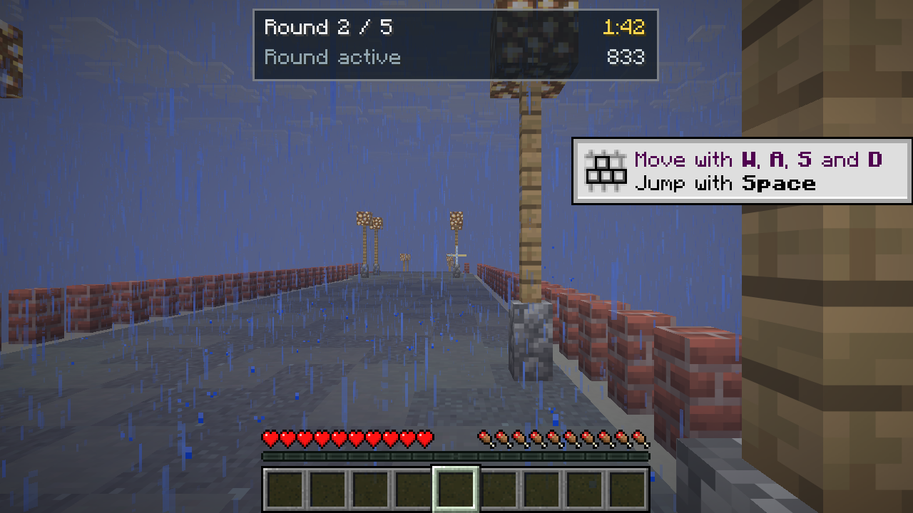
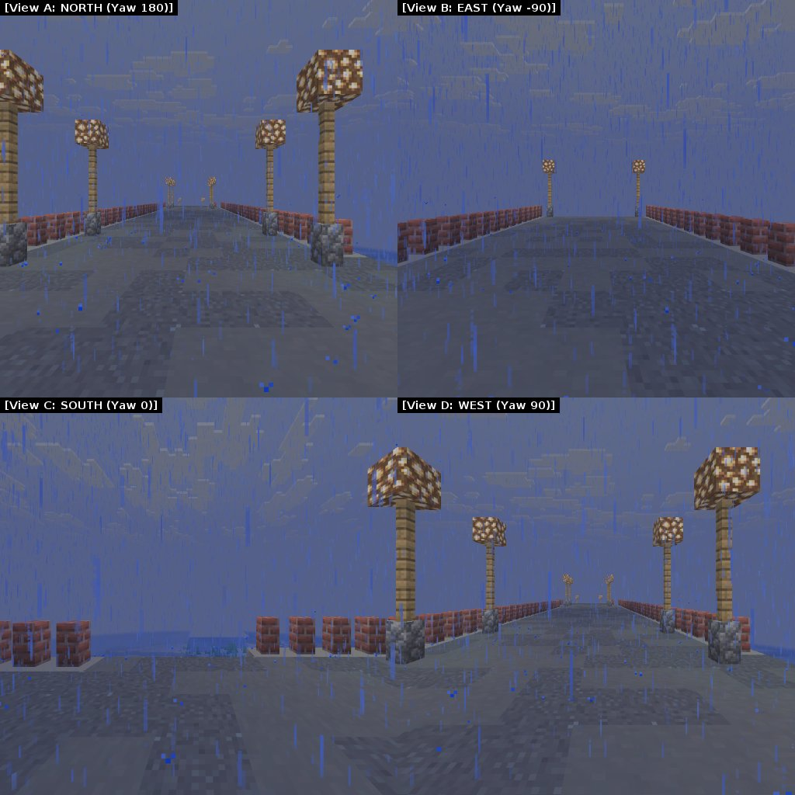
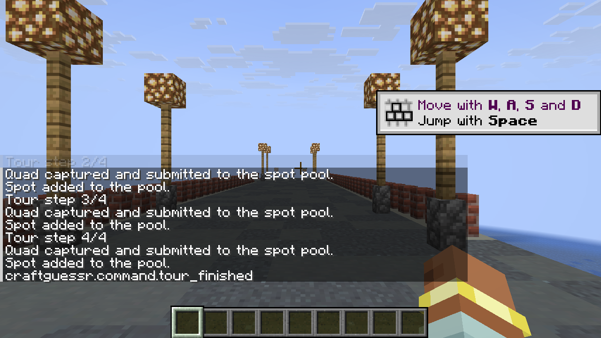
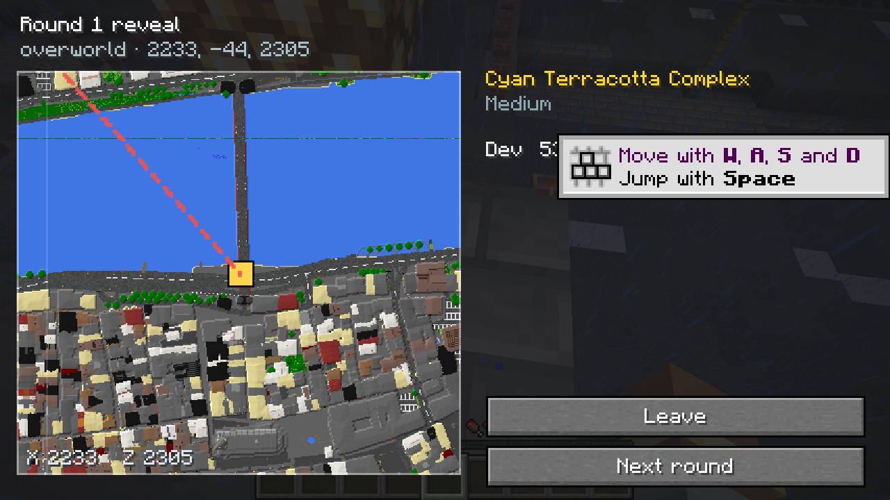
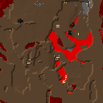
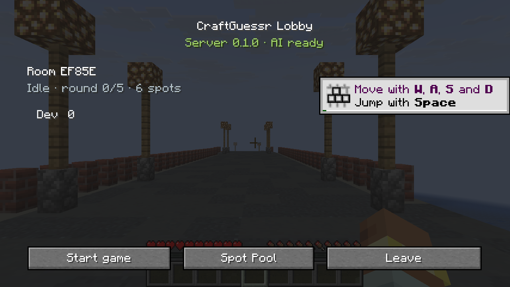
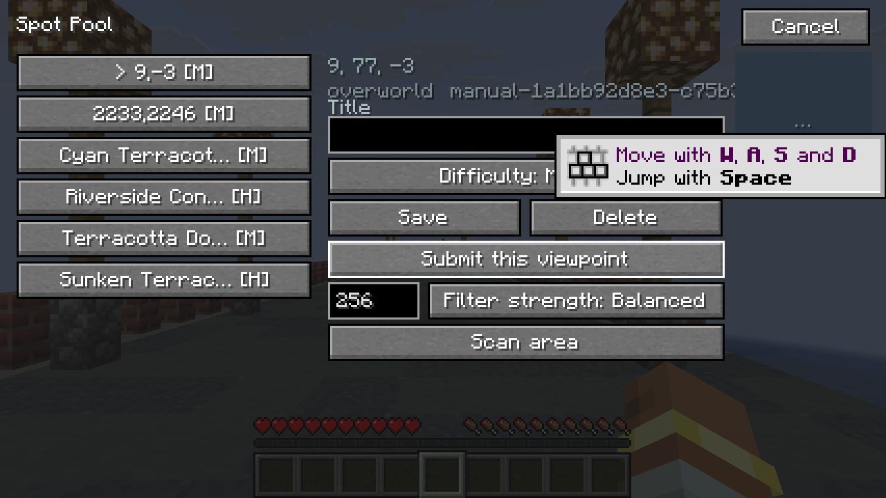

# CraftGuessr

A GeoGuessr-style game for **Minecraft 26.3 (Fabric)**. Players are dropped into a spot somewhere on your world, look around, and try to pin the location on an in-game map. The admin builds the spot pool either by hand or automatically, with an AI director choosing the best frames and writing the round titles.



## Features

- **AI spot scanning** — samples the terrain around the operator, pre-filters with a cheap local heuristic, renders a four-way panorama with ray casting and asks a vision model (OpenAI, Anthropic or Gemini protocol) whether the view is guessable. Returns keep/difficulty/title/commentary.
- **Quad capture** — `/geo capture` hides the HUD, switches to a 90° FOV, takes four 512² screenshots (N/E/S/W), labels them `[View A: NORTH (Yaw 180)]`… and submits a stitched 1024² JPEG to the spot pool.

  

- **Auto tour** — `/geo tour <radius> <count> [strength]` teleports the operator through pre-filtered candidates and drives the quad capture at every stop hands-free.

  

- **Native map pyramid** — three levels (1:1, 1:4, 1:16) rendered server-side from world data, streamed to the client, cached on disk and rate-limited. No Dynmap/BlueMap required.

  

- **Nether layers** — the nether has a separate roof layer and interior layer, toggleable on the map.

  

- **Game loop** — rooms and lobbies, configurable rounds/time/movement (Moving, No-Move, NMPZ), classic 5000-point scoring and streak mode, invisibility, forced arena snapshots and restore on disconnect.
- **Safety** — during rounds players are invulnerable, hostile mobs inside the arena are removed, mob spawning and mob griefing are disabled and restored afterwards. Snapshots persist across restarts.
- **Two-phase reveal** — full-screen map with animated dashed lines from every guess to the answer, plus a particle beam and the round leaderboard.
- **GUI** — lobby, room creation, spot-pool album with thumbnails, guess map with pan/zoom, reveal and game-over screens. Keys: **G** lobby, **M** map, **B** spot pool.

  
  

## Install

1. Minecraft **26.3** with **Fabric Loader** and **Fabric API**.
2. Drop `craftguessr-<version>.jar` (from the Releases page) into `mods/`.
3. Start the server once — `config/craftguessr/config.json` is created under the server directory.

### Configuration

```json
{
  "provider": "openai",
  "baseUrl": "https://api.deepseek.com",
  "apiKey": "sk-...",
  "model": "deepseek-flash",
  "maxConcurrency": 2,
  "timeoutSeconds": 90
}
```

Set it with `/geo config set <key> <value>` (operator only) or edit the file and run `/geo config reload`.
Anthropic-compatible endpoints need `/anthropic` appended to the base URL; Gemini uses the `gemini` provider.

## Commands

| Command | Description |
| --- | --- |
| `/geo lobby` | open the lobby |
| `/geo create` / `join <room>` / `leave` / `start` | room management |
| `/geo pool` | open the spot album |
| `/geo scan [radius] [strength]` | AI scan around the operator (`STRICT`, `BALANCED`, `RELAXED`, `WILD`) |
| `/geo capture [title] [difficulty]` | quad capture at the operator's position |
| `/geo tour [radius] [count] [strength]` | auto-pilot tour |
| `/geo tiletest [layer]` | render one map tile at the operator's position |
| `/geo tokens` | API usage and estimated cost |
| `/geo ping` | test the AI connection |

## Building

```bash
./gradlew build          # jar in build/libs
./gradlew runServer      # dev server
./gradlew runClient      # dev client
```

Java 25 is required. The development container is described in [docs/DEV_ENVIRONMENT.md](docs/DEV_ENVIRONMENT.md);
its headless client needs `-Dcraftguessr.softwareGL=1` to run under Xvfb/llvmpipe (it drops the SDL sRGB
framebuffer request that software GLX cannot satisfy).

## Design notes

Implementation notes for Minecraft 26.3, the module plan and the verification log live in
[PLAN.md](PLAN.md), [MC_26_3_API_GUIDE.md](MC_26_3_API_GUIDE.md) and [docs/STATUS.md](docs/STATUS.md).

## License

MIT — see [LICENSE](LICENSE).
